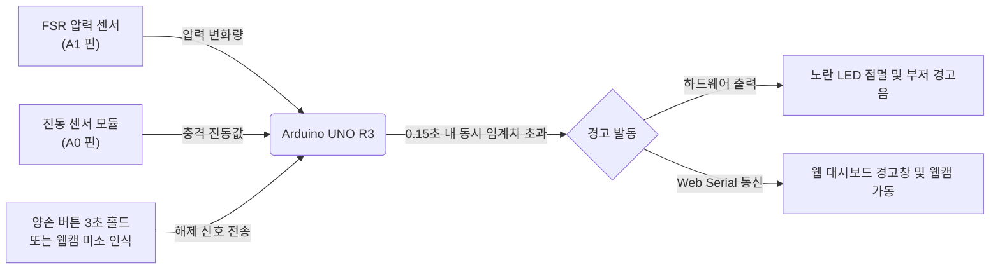
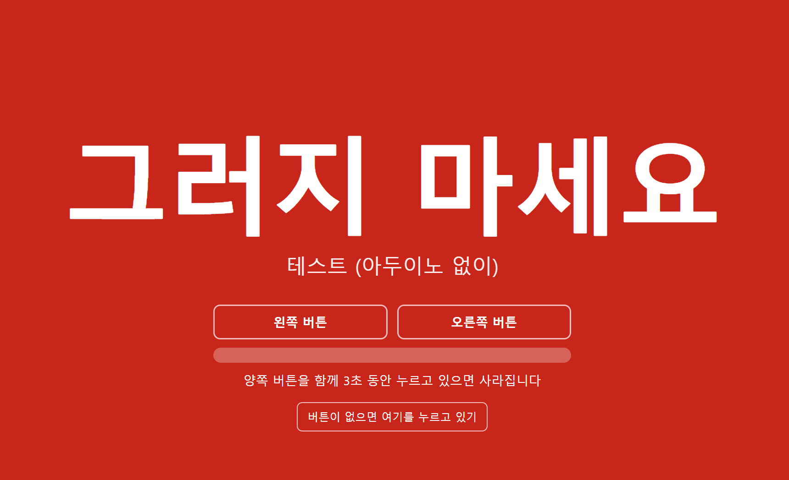

# ⌨️ 키보드 내려치기 감지기 (Keyboard Slam Detector)


> **압력(FSR) + 진동 센서 이중 검증과 웹캠 표정 인식을 결합한 분노 조절 및 하드웨어 보호 시스템**


## 📖 프로젝트 소개
게임이나 작업 중 순간적인 화를 참지 못하고 키보드를 강하게 내려치는 습관(일명 '샷건')을 방지하기 위해 제작한 아두이노·웹 연동 프로젝트입니다.
일반 타이핑과 실제 내려치기를 정밀하게 구분하며, 경고가 발생하면 물리적 버튼 조작과 웹캠 표정 미션을 통해 사용자의 감정을 진정시킵니다.


---


## ✨ 주요 기능
1. **이중 센서 정밀 감지 (오작동 방지)**
   * 압력 센서(FSR406)와 진동 모듈이 0.15초 이내에 동시에 임계치를 넘을 때만 내려치기로 판정합니다.
   * 키보드 무게나 손목을 올려두는 압력은 기준값에서 자동 제외되며, 10초 타자 보정 기능으로 사용자별 타건 강도에 맞출 수 있습니다.
2. **시각·청각 즉각 경고**
   * 감지 즉시 아두이노의 빨간 LED 점멸과 부저 경고음이 울리며, 웹 화면(`slam_final.html`)에 전체 경고창이 뜹니다.
3. **강제 쿨다운 해제 시스템**
   * **하드웨어 해제:** 키보드 양옆 택트 버튼 2개를 동시에 3초간 꾹 눌러야 해제됩니다.
   * **웹캠 표정 해제 (확장 기능):** 브라우저 내장 AI가 웹캠으로 얼굴을 인식해 일정 시간 동안 미소를 지어야 경고가 풀립니다.

---


## 🛠️ 하드웨어 구성 및 배선

| 부품명 | 아두이노 연결 핀 | 비고 |
| :--- | :--- | :--- |
| **압력 센서 (FSR406)** | `5V`, `A1` (`10kΩ` 저항 → `GND`) | 키보드 앞쪽 하단 동전 받침 위 배치 |
| **진동 모듈** | `S → A0`, `+ → 5V`, `- → GND` | 책상 표면에 테이프로 고정 |
| **택트 버튼 2개** | `A2`, `A3` (각각 반대편 `GND`) | 내부 풀업(`INPUT_PULLUP`) 사용 |
| **수동 부저** | `+ → D8`, `- → GND` | 경고음 출력 |
| **상태 LED (초록/빨강)** | `D9`, `D10` (각각 `220Ω` 저항 → `GND`) | 대기(초록) / 경고(빨강) 표시 |


---


## 회로 배선도


---


## 🔄 시스템 동작 구조 (System Architecture)




---


## 📸 하드웨어 구현 및 실행 화면

| 실제 하드웨어 세팅 | 웹 대시보드 및 경고 화면 |
| :---: | :---: |
|  |  |
| *키보드 하단 압력 센서 및 책상 진동 모듈 배치* | *충격 감지 시 웹 브라우저 경고 및 쿨다운 화면* |


---


```markdown
## 🛠️ 트러블슈팅 (Troubleshooting)

1. **일반 타자와 실제 '내려치기'의 오탐지 문제**
   * **문제:** 압력 센서(FSR)만 사용했을 때 스페이스바나 엔터 키를 강하게 치는 일반 타자도 내려치기로 오인식됨.
   * **해결:** 책상 표면에 부착한 진동 모듈을 추가해 **압력과 진동이 0.15초 이내에 동시에 임계치를 넘을 때만** 경고하도록 이중 검증 알고리즘을 적용함.

2. **키보드 자체 무게 및 손목 거치로 인한 센서 포화 현상**
   * **문제:** 키보드 무게가 압력 센서를 상시 누르고 있어 초기 기준값(Baseline)이 900 이상으로 치솟아 추가 충격 측정이 불가함.
   * **해결:** 동전 받침을 활용해 센서 접촉 면적과 초기 하중을 조절하고, 프로그램 시작 시 1초간 무부하 기준값을 자동 측정한 뒤 **10초 타자 보정(Calibration)**을 통해 사용자별 맞춤형 임계값을 산출하도록 개선함.

3. **진동 모듈의 과민 반응**
   * **문제:** 진동 모듈을 키보드 바로 밑에 두면 평범한 타건 진동까지 크게 잡혀 경고가 울림.
   * **해결:** 진동 모듈의 금색 압전 판을 키보드 하단이 아닌 **키보드 뒤쪽 책상 표면에 직접 테이프로 고정**하여 책상 전체를 울리는 강한 충격만 선별적으로 감지하도록 물리적 배치를 수정함.

---


## 🚀 실행 방법
1. **아두이노 업로드:** Arduino IDE에서 `slam_final.ino`를 열고 보드(`Arduino Uno`)와 포트를 선택한 뒤 업로드합니다. (업로드 후 시리얼 모니터는 닫아둡니다.)
2. **웹 대시보드 연결:** 크롬(Chrome) 또는 엣지(Edge) 브라우저로 `slam_final.html`을 엽니다. (Web Serial API 지원 브라우저 필수)
3. **센서 보정:** `[아두이노 연결]` 후 `[타자 보정 (10초)]` 버튼을 눌러 평소 타자 강도를 학습시킵니다.


---


## 👥 팀원 소개
| 이름 | GitHub | 담당 역할 |
| :--- | :--- | :--- |
| 권보민 | [@ppowwiuu](https://github.com/ppowwiuu) | 개선 아이디어 제안<br>• GitHub 레포지토리 구축, 기술 문서화 및 발표 자료 제작 |
| 김도현 | [@rlaehgusrnerne](https://github.com/rlaehgusrnerne) | 프로젝트 핵심 기획 및 문제 해결 아이디어 도출<br>• 임베디드 시스템 아키텍처 및 센서 회로도 설계 |
| 박서연 | [@seoyown](https://github.com/seoyown) | 기능 고도화 아이디어 제안 및 센서 캘리브레이션<br>• 임베디드 하드웨어 프로토타이핑 및 물리 회로 결선 |


---


## 🚀 향후 발전 방향
* **감정 데이터 통계 대시보드:** 시간대별·요일별 키보드 충격 빈도와 강도를 로컬 스토리지에 기록하여 개인별 스트레스 리포트 제공
* **소프트웨어 강제 휴식 연동:** 일정 횟수 이상 경고 누적 시 작업 화면 최상단 고정(PiP) 알림 및 강제 쿨다운 타이머 작동
* **무선(BLE) 모듈화:** USB 유선 연결 대신 ESP32 보드를 적용해 선 없는 깔끔한 데스크테리어 환경 지원

---

## 🎥 시연 영상 및 스크린샷
*(발표 전 실제 작동 사진이나 시연 GIF를 드래그해서 넣으면 평가 점수를 높이는 데 큰 도움이 됩니다.)*
